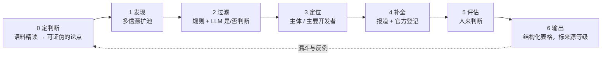

# sourcing-agent

**一个"先有判断、再找人"的 AI 辅助早期投资 sourcing 工作流。**

在公开信息里系统性地找到还没被市场发现的项目和创业者，用统一字段沉淀下来，并且每条信息都能追溯到来源。它最早用于一次 VC 笔试（近 30 天 AI for Science 融资项目 + GitHub 华人开发者），整理之后可以每周复用。



## 关于协作方式

本仓库在 AI 编程助手（Claude）的协助下完成代码与文档编写，这本身就是它想展示的工作方式：**人定判断，AI 做重复劳动。**

| 由我完成 | 由 AI 协助完成 |
|---|---|
| 提出可证伪的论点，决定第一题沿实验端链条、第二题沿智能体三层选题 | 按周切片调用 GitHub 搜索 API，扩大候选池 |
| 制定入选标准（时间窗口、国内项目需企查查记录在窗口内、创新型项目门槛） | 对候选做"是不是 AI4S""是不是教程仓库"这类是/否判断 |
| 人选与项目的最终取舍，例如用扰动之心替换窗口外的涌源合生 | 检索公开报道、个人主页与官方登记 |
| 企查查、SEC、法国企业登记等信息的人工复核，股权与融资口径的修正 | 起草表格、脚本与文档，统一排版 |
| 交付结构与表述的反复修订 | 按我的修改意见批量更新 |

## 为什么这样设计

| 原则 | 做法 |
|---|---|
| 先定判断，再选项目 | 第 0 步先读 20–30 篇近期材料，写出带"反证条件"的论点，再按论点在产业链上的位置去找项目，避免只复述融资新闻 |
| LLM 只做判断，不做生成 | 让模型回答"是不是 AI4S""是不是教程仓库"这类是/否问题；事实一律来自检索结果 |
| 每个数字都可追溯 | 来源分五级：`登记` / `公司` / `媒体` / `推算` / `待查`；人物年龄分 `证实` / `推断` / `未知` |
| 媒体口径和登记口径分开 | 融资同时记"公开披露日"和"监管/工商登记日"；对外宣称的金额和实际登记的金额分列 |
| 人在关键节点把关 | 论点设定、最终入选、年龄判定由人来做；机器负责扩大候选池和做重复劳动 |

## 目录

| 路径 | 内容 |
|---|---|
| [`AGENT.md`](AGENT.md) | 给 agent 的总指令：角色、六步流程、硬规则、交付标准 |
| [`playbooks/`](playbooks/) | 三类任务的操作手册：定判断、融资项目 sourcing、开源开发者 sourcing |
| [`schema/`](schema/) | 公司档案与开发者档案的字段定义（YAML） |
| [`channels/channels.md`](channels/channels.md) | 渠道表：怎么抓、产出多少、怎么失败 |
| [`channels/registry_checklist.md`](channels/registry_checklist.md) | 中、美、法、英、港的官方登记核查清单 |
| [`scripts/`](scripts/) | GitHub 发现与筛选脚本、抓取质量检查脚本 |
| [`templates/`](templates/) | 两类交付表格的模板 |
| [`runs/2026-11/`](runs/2026-11/) | 首次运行的漏斗与复盘（不含个人信息） |

## 快速开始

```bash
# 依赖：已登录的 GitHub CLI（gh auth login）、Python 3.9+
cd scripts
python3 github_discover.py --since 2026-08-04 --until 2026-11-04 --min-stars 1000 --out out/
python3 github_screen.py            # 读 out/raw_repos.json，输出漏斗与华人候选
python3 quality_checks.py page.txt --title-keyword PaperBenchX   # 检查抓取的正文是否被污染
```

在支持工具调用的 agent（如 Claude）里使用时，把 `AGENT.md` 作为系统指令，再按任务类型附上对应的 playbook。

## 首次运行的结果（2026-11）

- **融资项目**：两路检索汇总约 20 笔 → 候选 8 → 入选 5，链条为做实验 → 自产数据训模型 → 世界模型 → 材料闭环 → 闭环平台
- **GitHub 开发者**：780 → 666 → 198 → 19 → 5 → 3
- 详细复盘见 [`runs/2026-11/retro.md`](runs/2026-11/retro.md)

## 过程中的五个口径发现

1. **披露日不等于交割日。** 涌源合生 8 月 26 日完成工商变更，11 月 4 日才公布，企查查记录也在 8 月，因此未入选；Rivercell 9 月 3 日交割，10 月 7 日公布；Warp 在 SEC 登记的首次售股日是 10 月 16 日，公布是 10 月 22 日。
2. **注册资本推不出融资额。** 百奥几何的北京主体注册资本只有 5 万元，资金进入的是香港控股层；Rivercell 的增资名义金额只有约 37 万欧元，2500 万美元的大部分计入了资本溢价。
3. **融资额有多种口径。** Warp 对外宣称 2.15 亿美元，SEC 登记已售 1.946 亿美元；百奥几何对外称"A 系列累计超 1 亿美元"，企查查记为"数亿美元"。
4. **厂商自报的数字几乎没有独立复核。** 多家媒体常转载同一篇新闻稿，因此登记口径与公司口径要分开核对。
5. **人物年龄要看一手档案。** 项目走红时间、公司成立时间和本人入学时间常常对不上；第二题三人的入学年份均来自本人简历、学校公示或 OpenReview。

## 下一步

- [ ] 渠道按月归档落盘，解决 RSS 只返回最近 N 条的问题
- [ ] 同题异源聚类，避免把 PR 转载量当成热度
- [ ] 把 `claim_type: vendor / independent` 写进元数据
- [ ] 接入 arXiv、Hugging Face、Product Hunt 作为人物信号源
- [ ] 每周定时运行，输出"本周值得见的 5 个人"
